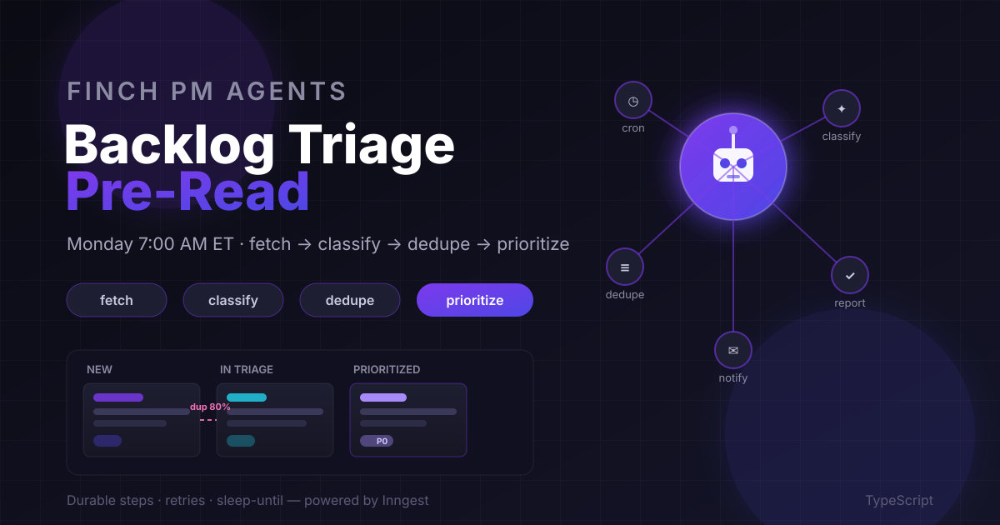
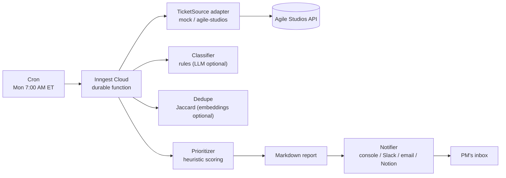
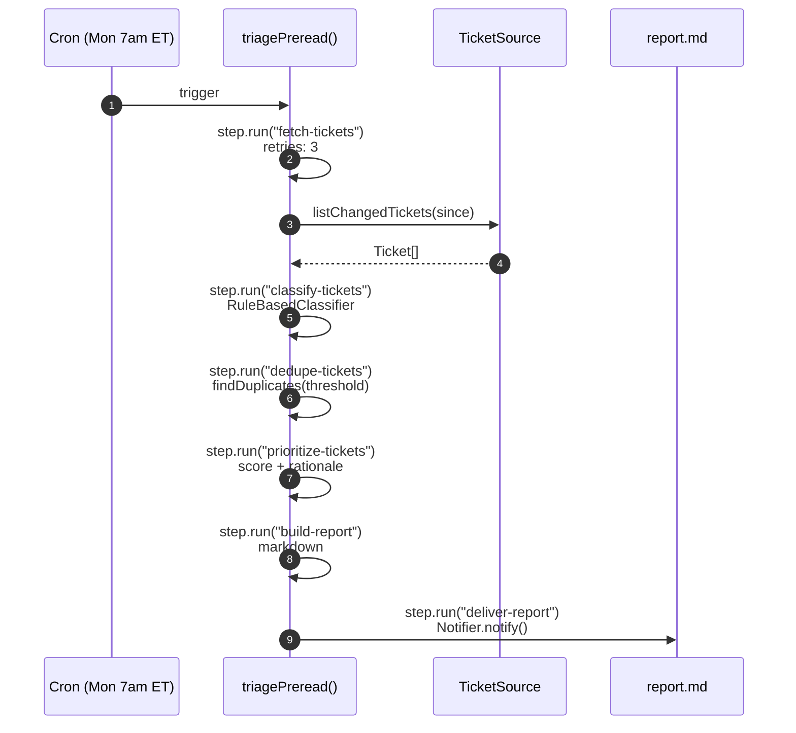

# Backlog Triage Pre-Read



An Inngest-powered Monday-morning agent for PMs. Every Monday at 7:00 AM (ET)
it fetches new/changed tickets from your backlog, classifies them, flags likely
duplicates, drafts a priority take, and delivers a markdown pre-read report —
so you walk into sprint triage with a first pass already done.

## Quickstart

```bash
npm install
cp .env.example .env   # TRIAGE_ADAPTER=mock works with zero credentials
npm run triage:mock    # full pipeline on sample data, report to stdout
```

Run the function on Inngest dev:

```bash
npm run serve                 # terminal 1 — serves :8288/api/inngest
npx inngest-cli@latest dev    # terminal 2 — Inngest dev server
```

Then trigger `backlog-triage-preread` from the Inngest dev UI, or wait for the
Monday 7am cron.

## How the triage pipeline works

Six durable steps (each a `step.run`, so a crash replays from the last
completed step instead of starting over):

| Step | What it does | Code |
|---|---|---|
| `fetch-tickets` | Pull changed tickets since `lookbackDays` ago via the `TicketSource` port | `src/adapters/` |
| `classify-tickets` | Rule-based classifier → bug / feature / tech-debt / spike / support / chore (LLM plug-in point included) | `src/lib/classify.ts` |
| `dedupe-tickets` | Token-overlap (Jaccard) similarity grouping; oldest ticket is primary | `src/lib/dedupe.ts` |
| `prioritize-tickets` | Heuristic score: category weight + age + label/priority signals + freshness; every point explained in the rationale | `src/lib/prioritize.ts` |
| `build-report` | GitHub-flavored markdown: ranked discuss-first list, duplicate groups, low-confidence flags | `src/lib/report.ts` |
| `deliver-report` | Pluggable notifier — console by default; Slack/email/Notion TODOs marked | `src/lib/notify.ts` |

All knobs live in `src/config.ts` (env-driven, zod-validated): timezone,
lookback window, project keys, confidence and duplicate thresholds.

## Wiring up the real Agile Studios adapter

The ticket source is a clean port (`src/adapters/ticket-source.ts`). The
Agile Studios implementation (`src/adapters/agile-studios.ts`) is scaffolded
with an explicit checklist — no endpoint paths were invented. To go live:

- [ ] **TODO-1** — Set `AGILE_STUDIOS_BASE_URL` in `.env` (ask your Agile Studios admin).
- [ ] **TODO-2** — Create an API token (Agile Studios → Settings → API tokens, read access) → `AGILE_STUDIOS_API_TOKEN`.
- [ ] **TODO-3** — Confirm the auth scheme in `apiGet()` (Bearer vs `Token` vs API-key header).
- [ ] **TODO-4** — Fill in the real search/list endpoint path + query params (marked `FILL-IN`).
- [ ] **TODO-5** — Map native fields in `mapToTicket()` (status/type/priority vocabularies).
- [ ] **TODO-6** — Wire pagination (cursor/offset/page) into `listChangedTickets()`.
- [ ] Set `TRIAGE_ADAPTER=agile-studios` and run `npm run triage:mock` (the script
      name stays — with the real adapter it hits the live API).

## Architecture

### System context



### Triage function flow



Deeper notes live in [docs/ARCHITECTURE.md](docs/ARCHITECTURE.md).
